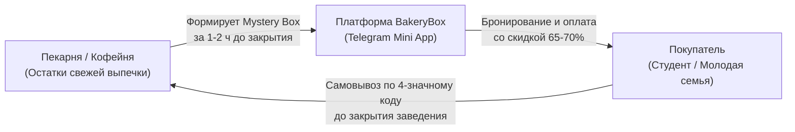

# 01. Концепция проекта, методика 5W и Бизнес-модель

## 1. Концепция продукта «BakeryBox»

«BakeryBox» («Свежий Сюрприз») — это двусторонняя платформа (маркетплейс в формате Telegram Mini App), соединяющая локальные ремесленные пекарни/кофейни с экономными городскими жителями.

### Двусторонняя ценность:
1. **Для пекарен (B2B):**
   * Срок годности ремесленной выпечки и слоек составляет 12–24 часа;
   * Ежедневно 10–25% качественной продукции идет в списание (убыток 30–60 тыс. ₽/мес на точку);
   * Сервис позволяет полностью окупить себестоимость сырья, ликвидировать списания и привлечь новый районный трафик без каннибализации дневных продаж.
2. **Для потребителей (B2C):**
   * Цены на премиальную выпечку выросли (круассан 180–250 ₽, десерт от 250 ₽);
   * Сервис дает возможность купить набор ремесленной продукции стоимостью 800–1 000 ₽ всего за **290–350 ₽**;
   * Эмоция «сюрприза» (Mystery Bag) и статус осознанного потребителя, спасающего еду от свалки.

---

## 2. Матрица 5W (Шеррингтона) — Документ «Практика Идея.docx»

| Вопрос | Содержание вопроса | Решение проекта «BakeryBox» |
| :--- | :--- | :--- |
| **What?** (Что?) | Ценность продукта для клиента (конечный результат, а не просто характеристики). | Набор-сюрприз («Magic Box») из 3–5 свежих позиций выпечки/десертов стоимостью от 800 ₽ за фиксированную цену 290 ₽. Клиент покупает не просто мучные изделия, а эмоцию гастрономического сюрприза («что попадется сегодня?»), радость выгодной покупки и статус осознанного потребителя, спасающего вкусную еду. |
| **Who?** (Кто?) | Портрет целевой аудитории (демография, доход, роли). | **B2C:** 1) Студенты и молодежь (18–25 лет) — экономные, живут рядом с ВУЗами, активные пользователи Telegram; 2) Молодые семьи и пары (23–35 лет) — вечерняя покупка к чаю или утреннему завтраку; 3) Осознанные потребители (Zero Waste). **B2B:** Управляющие и владельцы независимых ремесленных пекарен и кофеен. |
| **Why?** (Зачем?) | Глубинная мотивация клиента через технику «5 почему». | • *Почему покупает?* Хочет порадовать себя десертом/выпечкой вечером. • *Зачем?* Снять стресс после учебы/работы и вкусно поужинать. • *Почему в BakeryBox?* В кофейне это стоит 800 ₽, а в боксе — 290 ₽. • *Зачем именно сюрприз?* Элемент азарта и доступ к премиум-вкусам. • **Корень желания:** Получение высокого качества жизни и дофамина без переплаты. |
| **When?** (Когда?) | Момент возникновения потребности (триггеры, регулярность). | • Ежедневно с 19:30 до 22:00 (по дороге домой с учебы или офиса); • Пятничные вечера и выходные (посиделки с друзьями, просмотр сериалов); • Период за 2–3 дня до стипендии/зарплаты (потребность в жесткой экономии). |
| **Where?** (Где?) | Точки контакта, рекламы и совершения покупки. | • **Узнавание:** стикеры и тейбл-тенты на кассах пекарен-партнеров («Забери вечерний бокс в BakeryBox»), паблики районов/ВУЗов в Telegram, распаковки в Reels/VK Клипах; • **Покупка:** онлайн-бронирование и быстрая оплата по СБП в Telegram Mini App; • **Получение:** самовывоз в пекарне по 4-значному коду на экране телефона. |

---

## 3. Аннотация продукта — Документ «ПЗ1 (1).docx»

> **Формула продукта:**  
> **«BakeryBox»** — это **онлайн-сервис и Telegram Mini App бронирования «пакетов-сюрпризов» (Mystery Bags) со свежей ремесленной выпечкой и кондитерскими изделиями** для **студентов, молодых семей и городских жителей, любящих качественную еду**, которое **позволяет приобретать свежую продукцию премиального уровня со скидкой 60–70% за 1–2 часа до закрытия заведений, а пекарням — полностью окупать себестоимость непроданной за день выпечки и исключать списание свежей еды в мусор.**

---

## 4. Бизнес-модель Lean Canvas (9 блоков)

```mermaid
flowchart TD
    subgraph Lean_Canvas["Lean Canvas «BakeryBox»"]
        direction TB
        C1["<b>1. Целевая аудитория</b><br/>• B2C: Студенты (18-25), семьи (23-40)<br/>• B2B: Ремесленные пекарни, кофейни"]
        C2["<b>2. Проблема ЦА</b><br/>• Пекарни: 10-25% списаний в мусор<br/>• Клиенты: Высокие цены на десерты"]
        C3["<b>3. Ценностное предложение (УТП)</b><br/>• Премиум-выпечка на 900 ₽ за 290 ₽<br/>• 0 списаний и окупаемость сырья"]
        C4["<b>4. Решение</b><br/>• Telegram Mini App без скачивания<br/>• Гео-карта заведений<br/>• Бронь и самовывоз по 4-значному коду"]
        C5["<b>5. Каналы</b><br/>• Тейбл-тенты на кассах пекарен<br/>• Районные Telegram-каналы<br/>• Распаковки в Reels / Shorts"]
        C6["<b>6. Монетизация</b><br/>• Take-Rate: 22% с каждого бокса<br/>• Подписка BakeryBox Pass (199 ₽/мес)"]
        C7["<b>7. Издержки</b><br/>• Серверы, БД, разработка<br/>• Эквайринг СБП (0.7-1.2%)<br/>• POS-материалы и упаковка"]
        C8["<b>8. Метрики</b><br/>• GMV, Sell-through rate (>85%)<br/>• Retention 30 days, Частота покупок"]
        C9["<b>9. Нечестное преимущество</b><br/>• Двусторонний сетевой эффект района<br/>• Нулевой барьер входа через TMA<br/>• ESG-бренд «Спасаем еду»"]
    end
```

---

## 5. Диагностика этапа жизненного цикла проекта

Проект классифицирован как находящийся на этапе **1. Идея и концепция** (с переходом на этап **2. Исследование и разработка**).

* **Признаки текущего этапа:**
  1. Сформулировано ценностное предложение для обеих сторон рынка;
  2. Разработана и структурирована модель Lean Canvas, подтверждена юнит-экономика;
  3. Проведен расчет рынка TAM/SAM/SOM на основе официальной статистики;
  4. Проводятся качественные CustDev-интервью для валидации гипотез спроса;
  5. Проектируется кликабельный прототип Telegram Mini App (TMA).

