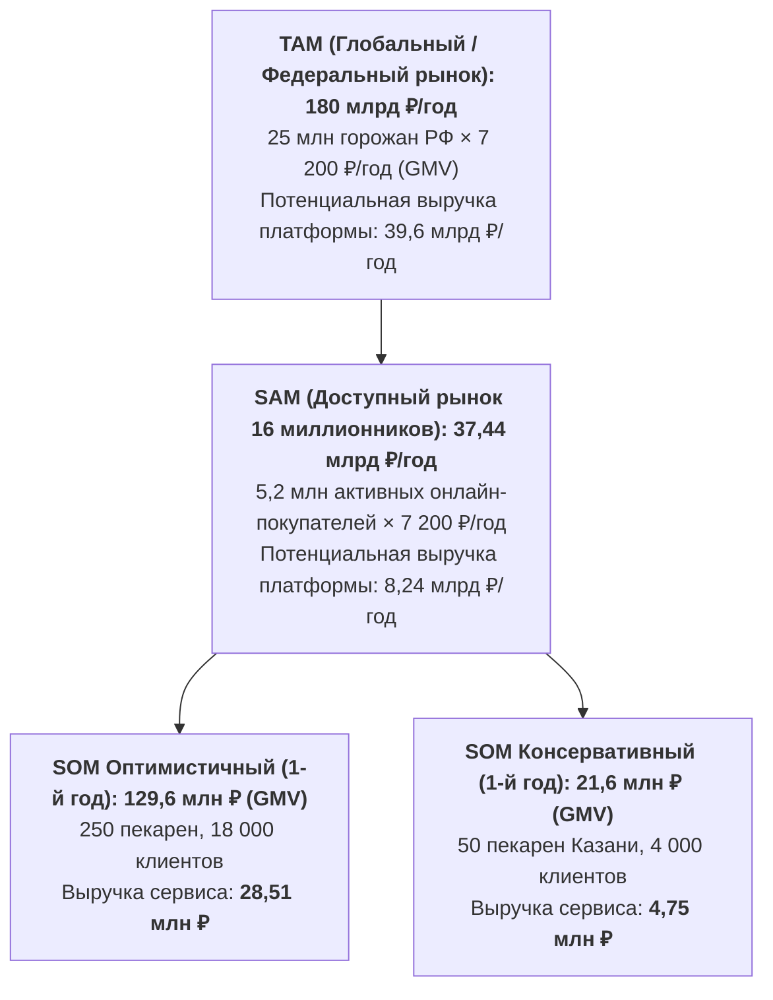
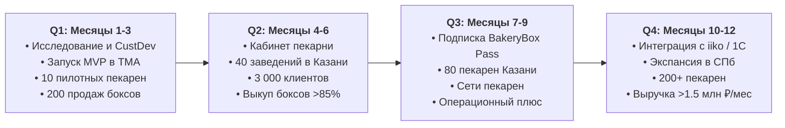

# 02. Расчеты объема рынка (TAM, SAM, SOM) и Дорожная карта (Roadmap)

## 1. Методология и источники данных

Для расчетов объемов рынка использованы открытые официальные статистические и отраслевые источники:
1. **Федеральная служба государственной статистики (Росстат):**
   * Данные по обороту общественного питания в РФ;
   * Реестр субъектов предпринимательской деятельности в сфере производства хлебобулочных и кондитерских изделий (в городах РФ действует более 22 000 пекарен, кондитерских и кофеен с собственной выпечкой);
   * Демографическая статистика по населению городов с численностью от 1 млн и от 500 тыс. человек.
2. **Отраслевое исследование INFOLine:**
   * Отчет «Рынок пекарен и кондитерских России» (2023–2024 гг.) — темпы роста сегмента ремесленных пекарен у дома (пекарни «у дома» показывают ежегодный прирост выручки 12–15%).
3. **Исследование НИУ ВШЭ и ТИАР-Центра:**
   * Аналитический доклад «Пищевые отходы в России: объем проблемы и решения в сегменте ритейла и HoReCa»: ежегодно в РФ выбрасывается около 17,9 млн тонн продовольствия стоимостью свыше 1,6 трлн рублей. На долю готовой скоропортящейся продукции пекарен и кулинарий приходится до 15% списаний.

---

## 2. Пошаговые математические расчеты

### 2.1. Расчет TAM (Total Addressable Market)
* **Целевая совокупность:** Все городское население РФ в возрасте 18–45 лет, покупающее готовую выпечку и десерты хотя бы 2 раза в месяц: **25 000 000 человек**.
* **Средний чек бокса:** **300 ₽**.
* **Частота покупок:** 2 раза в месяц = 24 покупки в год.
* **Средний годовой расход на клиента:**
  $$300 \text{ ₽} \times 24 = 7\,200 \text{ ₽/год}$$
* **Объем TAM в розничном товарообороте (GMV):**
  $$TAM_{GMV} = 25\,000\,000 \times 7\,200 \text{ ₽} = 180\,000\,000\,000 \text{ ₽} \quad (180 \text{ млрд ₽/год})$$
* **Объем TAM по выручке платформы (комиссия Take-Rate 22%):**
  $$TAM_{Rev} = 180 \text{ млрд ₽} \times 22\% = 39,6 \text{ млрд ₽/год}$$

---

### 2.2. Расчет SAM (Serviceable Available Market)
* **Географические и инфраструктурные ограничения:**
  * Ограничение 16 крупнейшими агломерациями и городами-миллионниками РФ (Москва, Санкт-Петербург, Казань, Екатеринбург, Нижний Новгород, Самара, Новосибирск и др.);
  * Высокая плотность ремесленных заведений (около 6 500 пекарен/кондитерских);
  * Высокое проникновение быстрых платежей (СБП) и использование смартфонов.
  * *Причины исключения малых населенных пунктов:* низкая плотность заведений, отсутствие избыточных остатков (пекут строго по штучному спросу), привычка готовить дома.
* **Доступная аудитория онлайн-покупателей в миллионниках:** **5 200 000 человек**.
* **Объем SAM в розничном товарообороте (GMV):**
  $$SAM_{GMV} = 5\,200\,000 \times 7\,200 \text{ ₽} = 37\,440\,000\,000 \text{ ₽} \quad (37,44 \text{ млрд ₽/год})$$
* **Объем SAM по потенциальной выручке платформы:**
  $$SAM_{Rev} = 37,44 \text{ млрд ₽} \times 22\% = 8,236 \text{ млрд ₽/год}$$

---

### 2.3. Расчет SOM (Serviceable Obtainable Market — 1-й год реализации)
**Фокус первого года:** Пилотный запуск в **г. Казань** (свыше 450 независимых пекарен и кондитерских, студенческий и гастрономический центр) с выходом на Санкт-Петербург во 2-м полугодии.

#### Сценарий А. Консервативный
* Подключение **50 партнерских пекарен** в Казани (~11% рынка города);
* Активная клиентская база: **4 000 человек**;
* Средняя частота покупок: 1,5 бокса в месяц (18 покупок в год);
* Годовой расход клиента: $18 \times 300 \text{ ₽} = 5\,400 \text{ ₽/год}$;
* **Годовой валовый оборот (GMV):**
  $$SOM_{cons} = 4\,000 \times 5\,400 \text{ ₽} = 21\,600\,000 \text{ ₽/год} \quad (21,6 \text{ млн ₽})$$
* **Доля от SAM:** $\frac{21,6 \text{ млн}}{37\,440 \text{ млн}} \approx 0,058\%$;
* **Чистая выручка сервиса (комиссия 22%):**
  $$21\,600\,000 \text{ ₽} \times 22\% = \mathbf{4\,752\,000 \text{ ₽/год}}$$

#### Сценарий Б. Оптимистичный
* Подключение **250 партнерских заведений** (150 в Казани + 100 точек на старте пилота в Москве/Санкт-Петербурге);
* Активная клиентская база: **18 000 человек**;
* Средняя частота покупок: 2 бокса в месяц (24 покупки в год = 7 200 ₽/год);
* **Годовой валовый оборот (GMV):**
  $$SOM_{opt} = 18\,000 \times 7\,200 \text{ ₽} = 129\,600\,000 \text{ ₽/год} \quad (129,6 \text{ млн ₽})$$
* **Доля от SAM:** $\frac{129,6 \text{ млн}}{37\,440 \text{ млн}} \approx 0,346\%$;
* **Чистая выручка сервиса (комиссия 22%):**
  $$129\,600\,000 \text{ ₽} \times 22\% = \mathbf{28\,512\,000 \text{ ₽/год}}$$

---

## 3. Драйверы роста и риски SOM

| Драйвер роста | Механизм влияния на показатели |
| :--- | :--- |
| **Вирусные распаковки в соцсетях** | Формат «Что мне положили в бокс за 290 ₽» в Reels/TikTok/Shorts снижает CAC практически до нуля. |
| **B2B-партнерства с сетями** | Подключение региональных франшиз («Добропек», «Хлебница», «Жизньмарт») кратно увеличивает плотность покрытия. |
| **Тренд на осознанность (Zero Waste)** | Растущая популярность экологической повестки среди молодежи формирует высокую лояльность (Retention). |

| Ключевой риск | Мера снижения / нивелирования |
| :--- | :--- |
| **Риск невыкупа собранных боксов** | Внедрение **100% обязательной онлайн-предоплаты** при бронировании в Telegram Mini App. |
| **Консерватизм пекарен** | Бесплатный тестовый период (14 дней без комиссии) для демонстрации окупаемости сырья. |
| **Сезонный спад (июль–август)** | Подключение кофеен с освежающими напитками, мороженым и сезонными ягодными десертами. |

---

## 4. Дорожная карта реализации проекта (Roadmap на 12 месяцев)

| Квартал | IT и разработка | B2B (Пекарни) | Маркетинг и продажи | Ключевая веха (Milestone) |
| :---: | :--- | :--- | :--- | :--- |
| **Q1** | • Кликабельный прототип Figma; • Бот и Telegram Mini App; • Подключение СБП. | • 25 интервью с управляющими; • Договоры с первыми 10 пилотными точками в Казани. | • Запуск пабликов проекта; • 40 интервью с покупателями; • Тейбл-тенты для касс. | **Запущен закрытый MVP на 10 пекарен, проведены первые 200 успешных продаж.** |
| **Q2** | • Личный кабинет пекарни; • Пуш-уведомления об остатках; • Модуль геолокации и карты. | • Расширение до 40 пекарен в Казани; • Регламент быстрой выдачи боксов. | • Таргетированная реклама; • Коллаборации с фуд-блогерами (распаковки). | **40 активных точек, 3 000 пользователей, >85% выкупаемости боксов.** |
| **Q3** | • Подписка «BakeryBox Pass»; • Аналитический дашборд списаний; • Оптимизация скорости карты. | • Расширение до 80 заведений; • Переговоры с сетями («Добропек», «Хлебница»). | • Реферальная программа; • Участие в студенческих фестивалях и маркетах. | **Операционная безубыточность в Казани (GMV > 1,8 млн ₽/мес).** |
| **Q4** | • Интеграция с кассами (iiko/1C); • Релиз приложений iOS/Android. | • 150 точек в Казани; • Экспансия в СПб (первые 50 точек). | • Федеральная PR-кампания «Zero Waste»; • Кросс-промо с эко-брендами. | **Сеть из 200+ пекарен в 2 городах, 18 000 клиентов, выручка > 1,5 млн ₽/мес.** |

