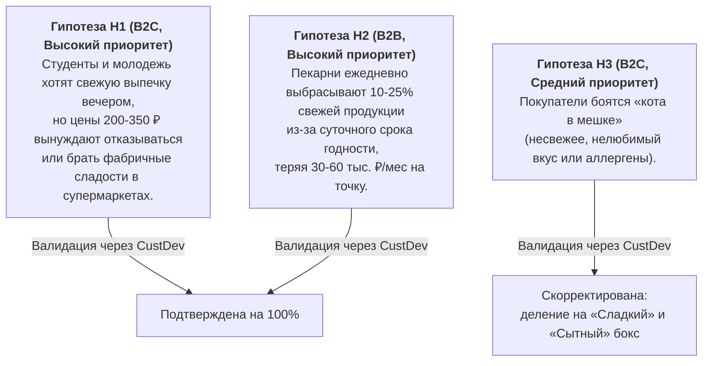

# 03. CustDev, проблемные интервью и фреймворк Jobs-to-be-Done (JTBD)

## 1. Гипотезы проблем и их приоритизация

1. **Гипотеза №1 (B2C — Покупатели, Приоритет: ВЫСОКИЙ):**
   * *Проблема:* Дороговизна свежей ремесленной выпечки и десертов в вечернее время.
   * *Проявление:* Студенты и молодежь хотят побаловать себя к чаю после 19:00, но чек 250–350 ₽ заставляет их уходить без покупки либо покупать фабричное печенье в дискаунтерах.
   * *Влияние:* Снижение качества питания, психологическая фрустрация.
   * *Критерий подтверждения:* $\ge 70\%$ подтверждают интерес к наборам со скидкой 60–70% за 250–300 ₽ в формате Mystery Box.
2. **Гипотеза №2 (B2B — Пекарни, Приоритет: ВЫСОКИЙ):**
   * *Проблема:* Непредсказуемые вечерние остатки и списание выпечки в мусор.
   * *Проявление:* Срок жизни слоек и круассанов — 12–24 часа; ежедневно списывается 10–25% объема смены.
   * *Влияние:* Прямой убыток 30–60 тыс. ₽/мес на точку, демотивация персонала.
   * *Критерий подтверждения:* 7 из 10 управляющих называют списания критической проблемой и готовы отдавать остатки через сервис с комиссией 22%.
3. **Гипотеза №3 (B2C — Барьер «кота в мешке», Приоритет: СРЕДНИЙ):**
   * *Проблема:* Опасение получить нелюбимый или несвежий продукт в закрытом боксе.
   * *Критерий подтверждения:* Введение двух базовых категорий («Сладкий бокс» / «Сытный бокс») и гарантии «выпечка сегодняшнего дня» снимает возражения у $\ge 80\%$ сомневающихся.

---

## 2. Скрипт проблемного интервью (The Mom Test)

Интервью построены по принципам книги Роба Фитцпатрика *«Спроси маму»*: вопросы задаются исключительно о **прошлом фактическом поведении**, без гипотетических фантазий («купили бы вы?»).

| № | Вопрос скрипта | Цель и влияние на гипотезы |
| :-: | :--- | :--- |
| **1** | «Расскажите, как часто и в каких ситуациях вы покупаете выпечку, хлеб или десерты у дома или учебы? В какое время суток чаще всего?» | Проверяет регулярность и фиксирует паттерн вечерних покупок (после 18:00). |
| **2** | «Вспомните последний раз, когда вы заходили в пекарню вечером (после 19:00). Что вы хотели купить, с чем столкнулись и чем все закончилось?» | Выявляет реальный негативный опыт (опустевшие витрины, завышенные цены). |
| **3** | «Бывало ли такое, что цена на пирожное казалась слишком высокой, и вы отказывались от покупки? Что вы сделали вместо этого?» | Проверяет остроту ценовой боли и альтернативы (супермаркет, чай без сладкого). |
| **4** | «Обращаете ли вы внимание на вечерние скидки на витринах пекарен (-20% или -30%)? Покупали ли что-то по ним за последний месяц?» | Проверяет привычку охоты за скидками и достаточность скидки 20–30%. |
| **5** | «Покупали ли вы когда-либо товары в формате «сюрприз-бокса» или вслепую? Что вам понравилось или насторожило?» | Тестирует восприятие концепции Mystery Box и страхи («кот в мешке»). |
| **6** | «Представьте, что хорошая пекарня у дома отдает за 290 ₽ крафтовый бокс со свежей выпечкой дня номиналом от 850 ₽. Что для вас стало бы решающим фактором „купить“ или „пройти мимо“?» | Выявляет критерии найма продукта (свежесть, бренд пекарни, понятная категория). |
| **7** | «Насколько для вас важно знать точный состав бокса заранее, или достаточно знать направление (сладкая выпечка vs сытная выпечка/хлеб)?» | Проверяет гипотезу №3 о категоризации наборов. |

---

## 3. Протоколы интервью и качественный анализ

| Вопрос скрипта | Респондент №1 (Студент, 21 год, общежитие) | Респондент №2 (Девушка, 26 лет, маркетолог) | Респондент №3 (Мужчина, 32 года, отец семейства) | Обобщенный вывод |
| :--- | :--- | :--- | :--- | :--- |
| **Частота и время** | 3–4 раза в неделю, после 19:30 по пути с пар. | 2–3 раза в неделю в 20:00–20:30 из метро. | 4–5 раз в неделю около 19:00 к завтраку. | **100% покупок происходят вечером по пути домой.** |
| **Вечерний опыт** | Полки пустые, либо остались пирожные по 320 ₽. | Любимых круассанов нет, брать случайное дорого. | Хлеб раскуплен, приходится идти в супермаркет. | Вечером скудный ассортимент по полной цене. |
| **Отказ из-за цены** | Уходит и берет в «Магните» сухие вафли за 80 ₽. | Уходит пить чай без сладкого, корит за траты. | На семью из 3 человек выходит дорого (>800 ₽). | Высокая цена — ключевой барьер покупки. |
| **Вечерние скидки** | Пользуется -20%, но считает скидку слабой (-30 ₽). | Скидка -25% привлекает, но к 20:00 выстраивается очередь. | Скидка 20–30% недостаточна для спец-поездки. | Скидка 20–30% воспринимается как незначительная. |
| **Опыт Mystery Box** | Обожает распаковки мерча и азиатских сладостей. | Боится аллергенов (арахис) и невкусных начинок. | Покупал «наборы дня» в лавках, доверяет качеству. | Формат интригует, но требует базовой прозрачности. |
| **Готовность за 290 ₽** | «Возьму не раздумывая! 290 ₽ за набор на 800 ₽ — подарок». | «Возьму, если это сладкое к чаю, а не ржаной хлеб». | «Куплю обязательно в известной районной пекарне». | **100% подтвердили готовность к покупке.** |
| **Категории** | «Съем всё, главное чтобы было свежее и сытное». | «Критично! Делите строго на сладкое и сытное». | «Достаточно деления на десерты и хлеб/выпечку». | **Необходимо четкое деление на 2 категории.** |

### Выводы и продуктовые инсайты:
1. **Инсайт №1 (Продуктовый):** Клиентам не нужен поштучный выбор, но жизненно важно разделить боксы на **«Сладкий бокс»** (круассаны, улитки, пирожные) и **«Сытный бокс»** (багеты, фокачча, пироги, сытная выпечка).
2. **Инсайт №2 (Маркетинговый):** Обязательна плашка «Только выпечка сегодняшнего дня» для снятия барьера просрочки.
3. **Инсайт №3 (Механика):** Предоплата в приложении дает покупателю спокойствие: бокс отложен персонально под него и гарантированно дождется его до закрытия.

---

## 4. Критерии выбора по Jobs-to-be-Done (JTBD)

> **Ключевая работа (Core Job):**  
> *«Когда я возвращаюсь вечером домой уставший и голодный, помоги мне за пару кликов получить пакет свежей вкусной выпечки и десертов из хорошей пекарни с огромной скидкой, чтобы я вкусно поужинал и поднял себе настроение, не переплачивая и не тратя время на готовку»*.

### Сравнительная таблица решений:

| Критерии найма (JTBD) | Предлагаемое решение «BakeryBox» | Конкурент 1: Вечерняя скидка в пекарне (-20%) | Конкурент 2: Супермаркет у дома («Магнит»/«Пятерочка») | Конкурент 3: Экспресс-доставка («Самокат»/«Лавка») |
| :--- | :--- | :--- | :--- | :--- |
| **1. Размер скидки и выгода** | **Высокая (60–70%)**. Набор на 900 ₽ отдается за 290 ₽. | **Низкая (20–30%)**. Чек падает с 300 до 230 ₽ за шт. | **Средняя**. Акции на фабричные позиции. | **Низкая**. Редкие скидки + наценка и сервисный сбор. |
| **2. Качество и свежесть** | **Высокое**. Ремесленная теплая выпечка сегодняшнего дня. | **Высокое**, но к вечеру витрина полупустая. | **Низкое/среднее**. Хлеб в пленке длительного хранения. | **Хорошее**, но фабричное производство. |
| **3. Гарантия наличия и удобство** | **Высокое**. Бронь и оплата заранее, бокс ждет клиента. | **Низкое**. Лотерея: часто полки уже пустые к приходу. | **Высокое**. Магазин открыт всегда, но выпечка не ремесленная. | **Максимальное**. Доставка до двери за 15–25 минут. |
| **4. Эмоциональный вау-эффект** | **Высокий**. Интрига Mystery Bag, дофамин от выгоды, спасение еды. | **Нейтральный**. Обычная покупка остатков со скидкой. | **Нулевой**. Рутинный бытовой поход в дискаунтер. | **Нейтральный**. Обычный заказ из каталога. |

---

## 5. Сценарии работ (Job Stories)

* **Job Story №1 (Студент / Молодежь — бюджетное вечернее лакомство):**  
  *«Когда я возвращаюсь в общежитие после тяжелого дня пар и вечерней подработки около 20:30,*  
  *Я ХОЧУ за минимальные деньги (250–300 ₽) забрать целый пакет свежих круассанов и десертов из хорошей кофейни рядом со станцией метро,*  
  *ЧТОБЫ сытно и вкусно попить чай с друзьями в комнате, поднять настроение и почувствовать себя человеком, не пробивая дыру в студенческом бюджете»*.

* **Job Story №2 (Работающий специалист / Офисный сотрудник — снятие стресса без готовки):**  
  *«Когда я выхожу из офиса после 19:30 уставший и морально выжатый,*  
  *Я ХОЧУ за 30 секунд в Telegram забронировать набор-сюрприз в пекарне на первом этаже моего дома,*  
  *ЧТОБЫ по пути домой забрать готовый вкусный вечерний перекус, порадовать партнера и не стоять у кухонной плиты после работы»*.

* **Job Story №3 (Семейный покупатель / Родитель — свежая выпечка к утреннему завтраку):**  
  *«Когда мы с супругой вечером гуляем с ребенком во дворе около 20:00,*  
  *Я ХОЧУ купить со скидкой 70% набор из свежего ремесленного хлеба, багета и сытной выпечки,*  
  *ЧТОБЫ утром быстро накормить семью вкусным и натуральным завтраком ресторанного качества, сэкономив семейный бюджет»*.

* **Job Story №4 (Сторонник Zero Waste / Осознанное потребление — спасение еды):**  
  *«Когда я вижу, сколько качественных продуктов ежедневно выбрасывается заведениями общепита,*  
  *Я ХОЧУ регулярно выкупать вечерние остатки еды через приложение,*  
  *ЧТОБЫ предотвратить выброс свежей пищи на свалку и внести личный вклад в снижение экологического следа в моем городе»*.

