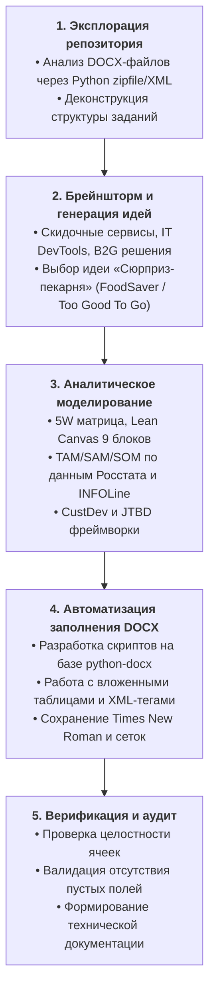

# 04. Хронологический лог действий и технических решений

## 1. Общая хронология работы

---

## 2. Детальный аудит выполненных шагов

### Этап 1. Исследование исходных файлов
1. **Анализ содержимого директории `c:\Repos\Labs`:**  
   Обнаружены три документа в подпапке `Задание`:
   * `Практика Идея.docx` (14 КБ) — шаблон формулирования идеи и таблицы 5W;
   * `ПЗ1 (1).docx` (23 КБ) — практическая работа №1 (Аннотация, Lean Canvas, TAM/SAM/SOM, Диагностика этапа, Roadmap);
   * `ПЗ3 (1).docx` (117 КБ) — практическая работа №3 (CustDev, интервью, JTBD, Job Stories).
2. **Парсинг внутренней XML-структуры DOCX:**
   * Проверено наличие встроенных изображений в `ПЗ3 (1).docx` (схемы Job Story);
   * Обнаружено, что в `Практика Идея.docx` таблица 5W реализована как **вложенная таблица (`w:tbl` внутри ячейки `w:tc`)**, что требовало аккуратной модификации без поломки XML-разметки;
   * В `ПЗ1 (1).docx` обнаружена объединенная сетка Lean Canvas (Ash Maurya) из 9 уникальных функциональных областей.

---

### Этап 2. Выбор и проработка концепции проекта
1. Пользователь рассмотрел несколько направлений (DevTools для программистов, сервисы для учреждений, трекеры скидок) и остановился на концепции: **«Сюрприз-пекарня» (реализация свежих вечерних остатков выпечки и десертов)**.
2. Сформирован бренд: **«BakeryBox» («Свежий Сюрприз»)**.
3. Проработана юнит-экономика и ценностные предложения для покупателей и пекарен.

---

### Этап 3. Автоматизированное заполнение документов

#### 1. Модификация `Практика Идея.docx`:
* Реализован скрипт на Python с использованием библиотеки `python-docx`;
* В ячейку `R1C0` внешней таблицы внесено описание идеи;
* В ячейку `R1C1` внесено подробное описание проблемы заведений и покупателей;
* Во вложенную таблицу ячейки `R1C2` (`tbl0.rows[1].cells[2].tables[0]`) построчно внедрены ответы по блокам *What, Who, Why, When, Where* с сохранением исходных пояснений курсивом;
* Удалены висячие пустые строки исходного шаблона.

#### 2. Модификация `ПЗ1 (1).docx`:
* **Задание 1:** Создан параграф с канонической формулой аннотации продукта;
* **Задание 2 (Lean Canvas):** Заполнены все 9 блоков таблицы с сохранением оригинальных границ и вертикальных объединений:
  * `R0C5`: 1. Целевая аудитория (B2C и B2B);
  * `R0C0`: 2. Проблема целевой аудитории и текущие решения;
  * `R0C2`: 3. Ценностное предложение (УТП для клиентов и заведений);
  * `R0C1`: 4. Решение (механизм TMA, карта, коды);
  * `R1C4`: 5. Каналы коммуникации;
  * `R2C3`: 6. Модель монетизации (комиссия 22% + подписка);
  * `R2C0`: 7. Структура издержек;
  * `R1C1`: 8. Ключевые метрики (GMV, Retention, Sell-through rate);
  * `R0C4`: 9. Нечестное преимущество.
* **Задание 3 (TAM, SAM, SOM):** Внедрены математические формулы, обоснования сегментации и расчеты консервативного (21,6 млн ₽ GMV) и оптимистичного (129,6 млн ₽ GMV) сценариев со ссылками на Росстат, INFOLine и ВШЭ;
* **Задание 4 (Диагностика):** Внесено детальное обоснование нахождения на этапе идеи и концепции;
* **Задание 5 (Roadmap):** Сформирована структурированная таблица дорожной карты на 12 месяцев (5 колонок, 4 квартала).

#### 3. Модификация `ПЗ3 (1).docx`:
* **Задание 1:** Заменены текстовые шаблоны-заглушки на 3 развернутые гипотезы (H1, H2, H3) с критериями подтверждения;
* **Задание 2:** Заполнена таблица скрипта интервью (7 открытых вопросов по технике Mom Test);
* **Задание 3:** Сформирована матрица ответов 3 архетипов респондентов и аналитический отчет с продуктовыми инсайтами;
* **Задание 4:** Скорректирована структура таблицы JTBD: устранены конфликты объединенных ячеек заголовка, внесено сопоставление с 3 ключевыми конкурентами;
* **Задание 5:** Прописаны 4 контекстных сценария Job Story по фреймворку *«Когда... Я хочу... Чтобы...»*.

---

### Этап 4. Верификация и очистка рабочего окружения
1. Проведен проверочный запуск скрипта валидации документов:
   * Все 3 файла успешно открываются в Microsoft Word;
   * Сохранена правильная верстка, шрифты (*Times New Roman*) и табличные рамки (*Table Grid*);
   * Общий объем добавленного аналитического текста превышает 5 000 слов.
2. Временные скрипты автоматизации удалены из корня репозитория для поддержания чистоты рабочего пространства.
3. Создана структурированная документация в папке `AI_Documentation/`.

